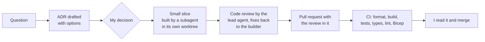

# How it was built

I built touchline-ai with AI coding agents (Claude Code). This page sets out what I did, what the agents did, and how I checked their work. The evidence is in this repository, mainly [DECISIONS.md](../DECISIONS.md), the tests and the commit history.

Most commits on `main` carry a `Co-Authored-By: Claude` line: 77 of the 105. The other 28 lost the line when the pull request was squash-merged, and they were made the same way.

## Who did what

| | Me | The agents |
|---|---|---|
| **Scope** | What the app does, what was in and out, and the order it was built in | Suggested options when I asked |
| **Architecture** | Every decision in DECISIONS.md: I chose an option, or overruled the recommendation | Drafted each ADR: the question, the options, a recommendation and the trade-offs |
| **Planning** | Broke the work into stages, lanes and small slices | Scouted a lane and proposed a slice plan |
| **Code** | Set the conventions, chose which fixes to make, and decided what to defer | Wrote the implementation and tests, and first drafts such as the KQL runbook queries in the README |
| **Review** | Read every pull request and merged all 104 myself | Ran a code review on each slice and recorded its findings |
| **Cost and quality gates** | Set the budgets, the switches that keep paid features off by default, the CI gates and the token caps | Worked inside them |

## The workflow

- **An ADR comes first.** Nothing that depended on a decision was built until I'd accepted it (the statuses at the top of DECISIONS.md). There are 73 ADRs, and many have amendments recording what changed once the code met reality.
- **Then a small pull request.** 104 were merged between 16 and 28 October 2026, all squash-merged into `main`.
- **Delegation.** From 24 October the lead agent handed each slice to a subagent with a narrow list of files to read. Cheaper models took well-pinned work, and the top model kept the engine, agents, UI and every review. The builder pushed its branch, the lead agent reviewed it, and the fixes went back to the same builder.
- **The review goes in the pull request.** From the 47th pull request onwards, each description has a *Code review* section listing the findings and what happened to each: fixed, accepted, deferred or no change. Earlier review fixes are recorded in the ADRs as "Review fixes".
- **CI gates every pull request:** `dotnet format --verify-no-changes`, build, the .NET tests, the web app's type check, lint, build and tests, a check that the TypeScript API types match the OpenAPI contract, and a Bicep build and lint ([ci.yml](../.github/workflows/ci.yml)).

## Controls on the AI

- **Tests.** 1,962 passing (1,585 .NET and 377 for the web app), plus 15 skipped. Unit tests never call a live model: they use a fake chat client ([FakeChatClient.cs](../tests/Touchline.Tests.Unit/Agents/FakeChatClient.cs)).
- **ADRs as the contract.** The agents built to the accepted ADR, and when the code had to differ, the ADR got an amendment saying so.
- **Token budgets on every model call.** Every chat client is wrapped in [TokenBudgetChatClient](../src/Touchline.Agents/TokenBudgetChatClient.cs), with a cap per agent from configuration (ADR-043).
- **Product guardrails.** The [roster guardrail](../src/Touchline.Agents/RosterGuardrail.cs) stops the agents naming anyone outside the two squads (ADR-044). Azure AI Content Safety checks fan team names against a blocklist of real names, and refuses a name when it can't get an answer (ADR-049).
- **Cost decisions.** Paid features (the models, AI Search, Content Safety, Redis, App Configuration) are off by default and turned on by a deploy switch. There's one Azure environment and no pre-production, under a monthly budget alert (ADR-011, ADR-026).

## A worked example: the recap guardrail

([ADR-044 amendment](../DECISIONS.md#adr-044--the-roster-guardrail-and-prompt-injection-defences); commit *Recap: skip sentence openers in the name guardrail*)

- **How I found it.** I'd never seen a full recap from the model arrive in Azure. The live API showed that for one match only the Casual English recap was the model's. Analyst mode and every Spanish and French recap had fallen back to the template.
- **Ruled out first.** The input token cap (a recap prompt measured about 1,100 tokens, against a 4,000 cap), the processor's settings and the deploy.
- **Root cause.** The roster guardrail treats an unknown capitalised word at the start of a sentence as a possible name, and its lists of ordinary sentence openers were short and mostly English. Recap prose opens sentences with words like *Victoria* and *Después* (Spanish), *Ensuite* (French), and *Pressing* and *Possession* (Analyst English). Each recap failed twice, fell back to the template, and was never retried.
- **Options.** Longer opener lists for each language, a list of analytics terms, or skipping the first word of every sentence in recaps.
- **Decision.** Skip each sentence's first word in recaps only, as the translation check already did. The rest of the sentence is still checked, so *Marco Rossi scored* is caught by *Rossi*. The Commentator, the Analyst and the search indexer keep the strict check, because their lines are short and often start with a name.
- **Why.** The lists are whack-a-mole: they'd miss the next ordinary word the model picks.
- **The trade-off I accepted.** An invented surname as the very first word of a recap sentence now gets through. The prompt still limits names to the match data, the facts the model sees carry only roster names, and Prompt Shields stay on.

## Where the AI got it wrong, and what I overruled

- **A review finding I reversed.** One code review said the blocklist should include real clubs' abbreviations, so a fan team couldn't use a real club's initials, and it was built. Three days later I took it out. Broadcasters use different codes for the same club, so there's no agreed set to block, and a list of three-letter codes kept refusing fans who wanted a short name. Initials are still checked for abuse. ([ADR-049, "No abbreviations on the blocklist"](../DECISIONS.md#adr-049--the-name-guard-fails-closed))
- **A recommendation I went beyond.** For Redis, the agent recommended caching name-guard verdicts and finished matches, but not the fan-match counters, because a cache without high availability can lose data. I added the counters, with Cosmos DB as the fallback whenever Redis is unreachable, so the limits still hold. ([ADR-061](../DECISIONS.md#adr-061--a-redis-cache-and-what-goes-in-it))
- **A design claim that wasn't true.** The pipeline ADR said a single trace would run from the simulator's send to the database writes. The first Azure runs showed otherwise. The SDKs' spans were off without an experimental switch, and then the Azure Monitor exporter's default sampler kept only 5 new traces a second, so most of the simulator's spans were dropped. Now every trace is kept, and the cost is measured against the daily cap. ([ADR-024, "What it corrects" and "Settled after the second Azure run"](../DECISIONS.md#adr-024--the-event-pipeline-in-azure-tiers-identities-and-the-simulator-job))
- **Arithmetic that was wrong.** The App Configuration plan estimated about 600 requests a day on the Free tier. Review found each refresh is two requests, and health probes were triggering refreshes too, so two instances passed the 1,000 limit. The refresh interval went to 15 minutes. A test also showed that an environment variable does *not* override a feature flag in the store, which the design had assumed, so the kill switches got their own override. ([ADR-062](../DECISIONS.md#adr-062--app-configuration-which-settings-and-flags-move))
- **A bug CI caught.** The match engine used `Math.Exp`, `Math.Log` and `Math.Cos`, which call the operating system's maths library. CI on Linux played a different match from the same seed than Windows did, from event 109 of seed 174. The engine now uses [PortableMath](../src/Touchline.Simulator/Engine/PortableMath.cs), built only from correctly rounded operations, and a test pins the exact bit patterns. ([ADR-001 update](../DECISIONS.md#adr-001--a-seeded-match-simulator-is-the-live-data-source))

## Numbers you can check

| | | How to check |
|---|---|---|
| Days | 13 (16 to 28 October 2026) | `git log --reverse --format=%ad --date=short` |
| Pull requests merged | 104 | every commit on `main` after the first is one squash-merged pull request |
| ADRs | 73 | `grep -c '^## ADR-' DECISIONS.md` |
| Tests | 1,962 passing, 15 skipped | `dotnet test` and `npm test` in `src/Touchline.MatchCentre.Web` |
| Commits with a Claude co-author line | 77 of 105 | `git log --format='%B%x00' \| tr -d '\n' \| tr '\0' '\n' \| grep -c "Co-Authored-By: Claude"` |

## What I'd do differently

- **A pre-production environment, and its trade-off.** A feature switched off for cost goes untested until production. This project was never going to make money, so for the same cost reason I didn't run a pre-prod environment, and the dropped traces, the recap guardrail and the App Configuration limits all showed up in the one live environment. On a real project I'd have pre-prod with cheaper models, but that brings its own trade-off: cheaper models never produce the same output as production. Whether pre-prod mirrors production exactly is a business decision, because it's paid for in model spend.
- **An alert on the template fallback rate.** The squad already counts every fallback to a template, with the reason ([SquadMetrics](../src/Touchline.Agents/SquadMetrics.cs)). The recap bug was found because I noticed I'd never seen a model recap, not because anything alerted. An alert on that counter would have found it on the first match.
